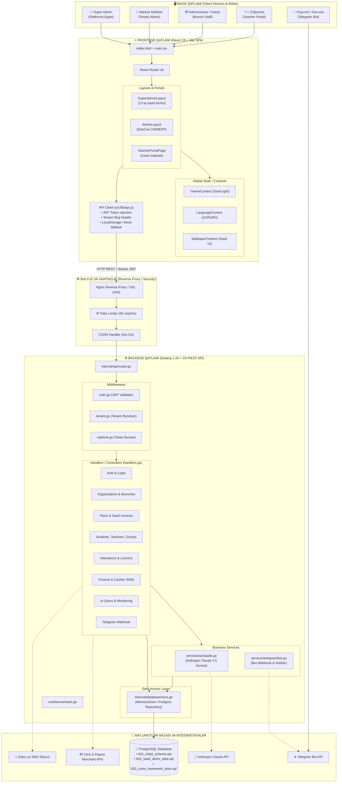
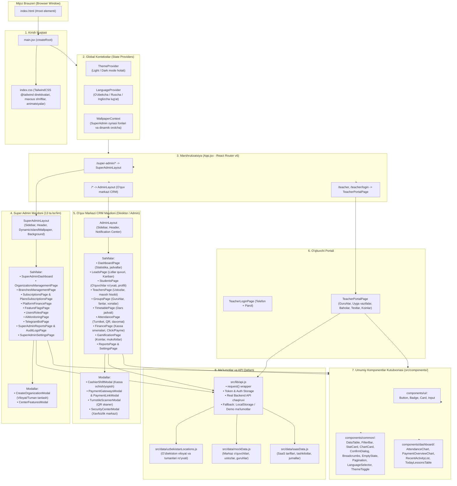
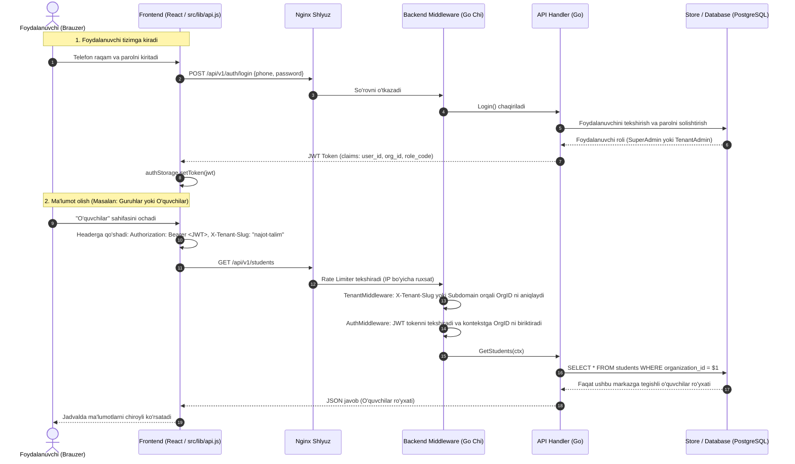

# 🚀 EduOne — Loyiha Arxitekturasi, Strukturasi va Yo'l Xaritasi (Roadmap)

Ushbu hujjat **EduOne** (O'quv markazlari va ta'lim muassasalarini boshqarishga mo'ljallangan ko'p ijarachili — Multi-Tenant SaaS platformasi) loyihasining to'liq arxitekturasi, har bir papka va faylining maqsadi, backend va frontendning alohida chizmalari hamda bosqichma-bosqich rivojlantirish rejasini (Roadmap) o'z ichiga oladi.

---

## 📑 Mundarija
1. [Loyiha Konsepsiyasi va Asosiy Qismlar](#1-loyiha-konsepsiyasi-va-asosiy-qismlar)
2. [1-Chizma: Umumiy Tizim Arxitekturasi (Full-Stack High-Level)](#2-1-chizma-umumiy-tizim-arxitekturasi-full-stack-high-level)
3. [2-Chizma: Backend Arxitekturasi (Go, Chi, PostgreSQL, Services)](#3-2-chizma-backend-arxitekturasi-go-chi-postgresql-services)
4. [3-Chizma: Frontend Arxitekturasi (React 19, Vite, TailwindCSS, State & Data Flow)](#4-3-chizma-frontend-arxitekturasi-react-19-vite-tailwindcss-state--data-flow)
5. [4-Chizma: Ko'p Ijarachilik (Multi-Tenancy) va So'rovlar Hayot Sikli](#5-4-chizma-kop-ijarachilik-multi-tenancy-va-sorovlar-hayot-sikli)
6. [Loyihaning To'liq Papka va Fayllar Strukturasi (File Tree)](#6-loyihaning-toliq-papka-va-fayllar-strukturasi-file-tree)
7. [Har Bir Papka va Faylning Batafsil Vazifasi](#7-har-bir-papka-va-faylning-batafsil-vazifasi)
   - [7.1 Ildiz (Root) Fayllari](#71-ildiz-root-fayllari)
   - [7.2 Backend Katalogi (`backend/`)](#72-backend-katalogi-backend)
   - [7.3 Frontend Katalogi (`src/`)](#73-frontend-katalogi-src)
8. [Loyiha Yo'l Xaritasi (Development & Deployment Roadmap)](#8-loyiha-yol-xaritasi-development--deployment-roadmap)

---

## 1. Loyiha Konsepsiyasi va Asosiy Qismlar

**EduOne** — bu bitta server va bitta platforma orqali yuzlab o'quv markazlariga xizmat ko'rsatuvchi B2B SaaS tizimi.

Platformada 3 ta mustaqil rol va boshqaruv maydoni mavjud:
1. **Super Admin Portali (`/super-admin`)**: EduOne platformasi asoschilari uchun. Markazlarni ro'yxatga olish, tariflar, SaaS hisob-fakturalari, sun'iy intellekt (Claude) sarfi, Telegram bot holati, audit jurnallari.
2. **O'quv Markazi Portali (`/`)**: Markaz rahbari va filial administratorlari uchun to'liq ERP/CRM (Lidlar, o'quvchilar, o'qituvchilar, guruhlar, jadvallar, turniket/davomat, kassa smenalari va Click/Payme to'lovlari, o'yinlashtirish — koinlar).
3. **O'qituvchi Portali (`/teacher`)**: Dars o'tuvchi ustozlar uchun qulay profil (Dars jadvali, talabalar davomati, baholash, uyga vazifa yuklash, koin berish, test natijalari).

---

## 2. 1-Chizma: Umumiy Tizim Arxitekturasi (Full-Stack High-Level)

Ushbu chizma foydalanuvchi brauzeridan to ma'lumotlar bazasigacha bo'lgan to'liq oqimni ifodalaydi:



---

## 3. 2-Chizma: Backend Arxitekturasi (Go, Chi, PostgreSQL, Services)

Backend **Clean Architecture** tamoyillariga asoslangan bo'lib, har bir qatlam qat'iy ajratilgan:

```mermaid
flowchart TD
    subgraph ClientReq["Mijoz So'rovi (Client Request)"]
        Req["HTTP So'rov (Headers, JWT, JSON Payload)"]
    end

    subgraph ServerInit["1. Server Kirish Nuqtasi (cmd/server/main.go)"]
        Cfg["config.Load()<br/>(.env o'qish, PORT, DB_URL, Claude_Key)"]
        InitStore["database.NewMemoryStore() / NewPostgresStore()"]
        InitAI["ai.NewAIService(cfg, store)"]
        InitBot["telegram.NewBotService(cfg, store)"]
        InitHandlers["handlers.NewAPIHandlers(cfg, store, ai, bot)"]
        InitRouter["api.NewRouter(cfg, apiHandlers)"]
        StartHTTPServer["http.Server.ListenAndServe(:8080)"]
    end

    subgraph RouterAndMiddlewares["2. Chi Router & Middleware Quvuri (router.go)"]
        MW_ReqID["chi/middleware.RequestID"]
        MW_RealIP["chi/middleware.RealIP"]
        MW_Logger["chi/middleware.Logger"]
        MW_Recover["chi/middleware.Recoverer"]
        MW_Timeout["chi/middleware.Timeout (60s)"]
        MW_CORS["go-chi/cors (Frontend origin ruxsatlari)"]
        MW_RateLimit["middleware.RateLimiter (IP bo'yicha)"]
        MW_TenantResolver["middleware.TenantMiddleware (X-Tenant-Slug tekshirish)"]
        MW_AuthJWT["middleware.AuthMiddleware (JWT claims parsing)"]
    end

    subgraph EndpointsGroup["3. Yo'naltirish (Route Groups)"]
        PublicRoutes["Ochiq Yo'llar:<br/>• GET /health<br/>• POST /api/v1/auth/login<br/>• POST /api/v1/telegram/webhook"]
        AIRoutes["AI Xizmati:<br/>• POST /api/v1/ai/query"]
        SuperAdminRoutes["Super Admin Guruh (/api/v1/super-admin):<br/>• /stats, /organizations, /branches<br/>• /plans, /features, /invoices, /audit-logs"]
        TenantCRMRoutes["Tenant CRM Guruh (/api/v1/tenant):<br/>• /students, /teachers, /groups<br/>• /attendance, /finance/shifts, /gamification"]
    end

    subgraph HandlersLayer["4. Handlers / Controllers (handlers/handlers.go)"]
        H_LoginFn["Login() -> JWT Token berish"]
        H_OrgFn["GetOrganizations(), CreateOrganization(), UpdateOrg()"]
        H_BranchFn["AddBranch(), ToggleBranchStatus()"]
        H_FinFn["CreateInvoice(), RecordPayment(), GetCashierShifts()"]
        H_AIFn["HandleAIQuery() -> Prompt + RAG Context"]
        H_BotFn["HandleTelegramWebhook() -> Command / Message routing"]
    end

    subgraph ServicesLayer["5. Tashqi Servislar (internal/services/)"]
        subgraph AIService["AI Servisi (claude.go)"]
            ClaudeCall["Anthropic Claude API ga so'rov"]
            TokenCalc["Tokenlar hisobi va sarf-xarajatni yozish"]
            AIUsageLog["Audit / AIUsageLog ga saqlash"]
        end
        subgraph BotService["Telegram Servisi (bot.go)"]
            BotCommands["/start, /balance, /homework, /schedule"]
            BotSender["Xabarlar jo'natish (SendMessage)"]
        end
    end

    subgraph DataLayer["6. Xotira va Ma'lumotlar Bazasi (internal/database/ & models/)"]
        subgraph DataModels["internal/models/models.go"]
            M_User["User, UserClaims"]
            M_Org["Organization, Branch"]
            M_Plan["Plan, FeatureFlag, Invoice"]
            M_Edu["Student, Teacher, Group, Lesson, Attendance"]
            M_Coin["CoinTransaction, Homework, TestAttempt"]
        end
        subgraph StorageCore["internal/database/store.go"]
            MemoryStorage["MemoryStore (Mutex himoyalangan xotira)"]
            PostgresStorage["PostgresStore (GORM / pgx Pool)"]
        end
    end

    subgraph SQLMigrations["7. Migratsiyalar (migrations/)"]
        Mig1["001_initial_schema.sql (Asosiy multi-tenant jadvallar)"]
        Mig2["002_seed_demo_data.sql (Boshlang'ich test ma'lumotlari)"]
        Mig3["003_coins_homework_tests_finances.sql (Koinlar, kassa, testlar)"]
    end

    %% Oqimlar
    Req --> ServerInit --> RouterAndMiddlewares
    RouterAndMiddlewares --> EndpointsGroup
    EndpointsGroup --> HandlersLayer
    HandlersLayer --> ServicesLayer
    HandlersLayer --> StorageCore
    ServicesLayer --> StorageCore
    StorageCore --> DataModels
    StorageCore -.-> SQLMigrations
```



---

## 4. 3-Chizma: Frontend Arxitekturasi (React 19, Vite, TailwindCSS, State & Data Flow)

Frontend zamonaviy **React 19** ekotizimida qurilgan bo'lib, quyidagi qatlamlardan iborat:



---

## 5. 4-Chizma: Ko'p Ijarachilik (Multi-Tenancy) va So'rovlar Hayot Sikli

EduOne-da har bir so'rov qanday aniqlanadi va ma'lumotlar qanday ajratiladi:



---

## 6. Loyihaning To'liq Papka va Fayllar Strukturasi (File Tree)

Quyida `EduOne` loyihasidagi mavjud va to'liq fayl iyerarxiyasi keltirilgan:

```text
EduOne/
├── .gitignore                                # Git nazoratidan chiqariladigan fayllar (node_modules, dist, .env)
├── .oxlintrc.json                           # JavaScript/React tezkor linter qoidalari
├── FIXES-THIS-REVISION.md                   # Oxirgi o'zgartirishlar, tuzatishlar va test xulosasi
├── README.md                                # Loyihaning asosiy ma'lumotnomasi
├── index.html                               # Brauzer uchun asosiy HTML shablon (Google Fonts, root div)
├── package.json                             # Frontend bog'liqliklari (React 19, Lucide, Tailwind, Vite)
├── package-lock.json                        # Paketlar versiyalari qulfi
├── postcss.config.js                        # TailwindCSS va Autoprefixer uchun PostCSS konfiguratsiyasi
├── tailwind.config.js                       # Tailwind mavzulari, ranglar, shriftlar, animatsiyalar
├── vite.config.js                           # Vite server konfiguratsiyasi (React plugin, port, aliaslar)
│
├── backend/                                 # 🚀 GOLANG REST API SERVER KATALOGI
│   ├── .env.example                         # Muhit o'zgaruvchilari shabloni (PORT, DB_URL, CLAUDE_KEY)
│   ├── go.mod                               # Go modullari va kutubxonalar ro'yxati (Go 1.24, Chi, JWT)
│   ├── go.sum                               # Go kutubxonalari checksumlari
│   │
│   ├── cmd/                                 # Ishga tushirish fayllari (Entrypoints)
│   │   └── server/
│   │       ├── main.go                      # Backend serverning asosiy kirish nuqtasi (main funksiya)
│   │       └── main_test.go                 # Backend serverning integratsion va unit testlari
│   │
│   ├── internal/                            # Ichki yopiq paketlar (Clean Architecture)
│   │   ├── api/                             # API shlyuzi va yo'naltirgichlar
│   │   │   ├── router.go                    # Chi Router sozlamasi, CORS, Rate Limit, Marshrutlar
│   │   │   ├── handlers/
│   │   │   │   └── handlers.go              # Barcha HTTP Controller funksiyalari (Auth, Orgs, Plans, Invoices)
│   │   │   └── middleware/
│   │   │       ├── auth.go                  # JWT Tokenni tekshirish va Claims ajratish middleware'i
│   │   │       ├── ratelimit.go             # Token-bucket algoritmli IP so'rov cheklovchi (Rate Limiter)
│   │   │       └── tenant.go                # Multi-tenancy: So'rov qaysi tashkilotga tegishli ekanini aniqlovchi
│   │   │
│   │   ├── config/
│   │   │   └── config.go                    # Muhit o'zgaruvchilarini (.env) yuklovchi va tekshiruvchi modul
│   │   │
│   │   ├── database/
│   │   │   └── store.go                     # Xotiradagi (In-Memory) va SQL ma'lumotlar bazasi abstraksiyasi
│   │   │
│   │   ├── models/
│   │   │   └── models.go                    # Go turlar va ma'lumotlar tuzilmalari (User, Org, Branch, Plan...)
│   │   │
│   │   └── services/                        # Tashqi biznes va uchinchi tomon xizmatlari
│   │       ├── ai/
│   │       │   └── claude.go                # Anthropic Claude 3.5 Sonnet AI moduli va token hisoblagich
│   │       └── telegram/
│   │           └── bot.go                   # Telegram Bot Webhook qabul qiluvchi va xabarnomalar servisi
│   │
│   └── migrations/                          # PostgreSQL ma'lumotlar bazasi migratsiya fayllari
│       ├── 001_initial_schema.sql           # Asosiy jadvallar: organizations, branches, users, roles, plans
│       ├── 002_seed_demo_data.sql           # Dastlabki test va namoyish ma'lumotlari (Demo markazlar, adminlar)
│       └── 003_coins_homework_tests_finances.sql # Koinlar, uyga vazifalar, testlar, kassa smenalari jadvallari
│
└── src/                                     # ⚡ REACT FRONTEND KATALOGI
    ├── App.jsx                              # Asosiy ilova komponenti, marshrutlar (React Router v6)
    ├── main.jsx                             # React DOM render nuqtasi va provayderlar
    ├── index.css                            # Asosiy stillar, Tailwind importlari, maxsus skrollbar va animatsiyalar
    │
    ├── assets/                              # Statik rasmlar, piktogrammalar va media fayllar
    │
    ├── context/                             # Global holat kontekstlari (Context API)
    │   ├── LanguageContext.jsx              # Tilni o'zgartirish (O'zbek, Rus, Ingliz) va lug'at tarjimalari
    │   └── ThemeContext.jsx                 # Mavzuni o'zgartirish (Dark / Light) va saqlash
    │
    ├── data/                                # Statik va lokal namoyish ma'lumotlari (Mock datasets)
    │   ├── mockData.js                      # O'quv markazi CRM ma'lumotlari (O'quvchilar, lidlar, davomat)
    │   ├── saasData.js                      # SuperAdmin SaaS ma'lumotlari (Tariflar, hisob-fakturalar, jurnallar)
    │   └── uzbekistanLocations.js           # O'zbekistonning 14 ta hududi va barcha tuman/shaharlari ro'yxati
    │
    ├── lib/                                 # Yordamchi kutubxonalar va mijozlar
    │   ├── api.js                           # Backend bilan aloqa qiluvchi to'liq API mijoz (REST Client)
    │   └── utils.js                         # Yordamchi funksiyalar (Sana formatlash, summani formatlash, cn)
    │
    ├── components/                          # Qayta ishlatiluvchi UI va mantiqiy komponentlar
    │   ├── attendance/
    │   │   └── TurnstileScannerModal.jsx    # QR-kod va karta orqali davomat qiluvchi turniket simulyatori
    │   │
    │   ├── common/                          # Universal va yordamchi komponentlar (16 ta)
    │   │   ├── Breadcrumbs.jsx              # Sahifalararo navigatsiya zanjiri
    │   │   ├── ChartCard.jsx                # Grafik va diagrammalar uchun konteyner karta
    │   │   ├── ConfirmDialog.jsx            # O'chirish yoki tasdiqlash uchun modal muloqot oynasi
    │   │   ├── DataTable.jsx                # Universal qidiruv, saralash va sahifalashga ega jadval
    │   │   ├── EmptyState.jsx               # Ma'lumot yo'q bo'lganda ko'rsatiladigan chiroyli blok
    │   │   ├── ErrorState.jsx               # Xatolik yuz berganda qayta urinish tugmasi bor xabar
    │   │   ├── FeatureToggle.jsx            # Modullarni yoqish/o'chirish tugmachasi (Switch)
    │   │   ├── FilterBar.jsx                # Filtrlash va qidiruv paneli
    │   │   ├── LanguageSelector.jsx         # Til tanlash menyusi
    │   │   ├── LoadingState.jsx             # Yuklanish indikatori (Spinner/Skeleton)
    │   │   ├── PageHeader.jsx               # Sahifa sarlavhasi va o'ng tarafdagi harakatlar bloki
    │   │   ├── Pagination.jsx               # Sahifalarni varaqlash komponenti
    │   │   ├── StatCard.jsx                 # Kichik statistik ko'rsatkich kartasi
    │   │   ├── StatusBadge.jsx              # Statuslarni rangli ko'rsatuvchi belgi (Active, Trial, Blocked)
    │   │   ├── SubscriptionSummary.jsx      # Markazning joriy tarifi va obuna holati qisqacha kartasi
    │   │   └── ThemeToggle.jsx              # Tun/Kun rejimini almashtirish tugmasi
    │   │
    │   ├── dashboard/                       # Asosiy boshqaruv paneli vidjetlari
    │   │   ├── AttendanceChart.jsx          # Haftalik/oylik davomat foizi grafigi
    │   │   ├── MetricCard.jsx               # O'quvchilar, daromad, qarzdorlar ko'rsatkichi
    │   │   ├── PaymentOverviewChart.jsx     # Tushumlar va to'lov turlari diagrammasi
    │   │   ├── RecentActivityList.jsx       # Oxirgi kiritilgan to'lovlar va harakatlar ro'yxati
    │   │   └── TodayLessonsTable.jsx        # Bugungi rejalashtirilgan darslar jadvali
    │   │
    │   ├── finance/                         # Moliya va to'lov modallari
    │   │   ├── CashierShiftModal.jsx        # Kassir smenasini ochish, yopish va inkassatsiya qilish
    │   │   ├── PaymentGatewaysModal.jsx     # Click, Payme, Uzum to'lov tizimlarini ulash sozlamalari
    │   │   └── PaymentLinkModal.jsx         # O'quvchiga SMS orqali to'lov havolasi (link) yuborish
    │   │
    │   ├── layout/                          # O'quv markazi CRM shablon komponentlari
    │   │   ├── AdminLayout.jsx              # Markaz admini asosiy konteyneri (Sidebar + Header + Outlet)
    │   │   ├── Header.jsx                   # Markaz boshqaruv panelining yuqori paneli (Filial, Qidiruv, Profil)
    │   │   └── Sidebar.jsx                  # Markaz boshqaruvining chap menyusi (Lidlar, Guruhlar, Moliya...)
    │   │
    │   ├── security/                        # Xavfsizlik komponentlari
    │   │   └── SecurityCenterModal.jsx      # IP cheklovlar, ikki bosqichli autentifikatsiya (2FA) va sessiyalar
    │   │
    │   ├── superadmin/                      # SuperAdmin maxsus interfeys elementlari
    │   │   ├── CenterFeaturesModal.jsx      # Markazlarga alohida modullarni (Turniket, AI, Bot) yoqish/o'chirish
    │   │   ├── CreateOrganizationModal.jsx  # Yangi o'quv markazi yaratish (Viloyat/Tuman bog'langan selektori bilan)
    │   │   ├── DynamicIslandWallpaper.jsx   # Yuqori panel uchun zamonaviy Dynamic Island animatsion vidjeti
    │   │   ├── SuperAdminBackground.jsx     # SuperAdmin uchun to'q sapfir va binafsharang oynaviy fon
    │   │   ├── SuperAdminHeader.jsx         # SuperAdmin yuqori navigatsiyasi va bildirishnomalari
    │   │   ├── SuperAdminLayout.jsx         # SuperAdmin asosiy sahifalar karkasi
    │   │   ├── SuperAdminSidebar.jsx        # SuperAdmin 13 ta bo'limdan iborat navigatsiya menyusi
    │   │   └── WallpaperContext.jsx         # SuperAdmin oynasi fon rasmlari va effektlari boshqaruvi
    │   │
    │   └── ui/                              # Bazaviy UI elementlar
    │       ├── Badge.jsx                    # Rangli teg/belgi
    │       ├── Button.jsx                   # Universal tugma (Variants: primary, outline, danger, ghost)
    │       ├── Card.jsx                     # Glassmorphism va oq/qora fonli karta
    │       └── Input.jsx                    # Qidiruv va formalar uchun stil berilgan kiritish maydoni
    │
    └── pages/                               # Asosiy sahifalar komponentlari
        ├── AttendancePage.jsx               # Davomat olish, jurnallar, turniket jurnali va QR skaner
        ├── DashboardPage.jsx                # O'quv markazi asosiy bosh sahifasi (KPI, tezkor harakatlar)
        ├── FinancePage.jsx                  # Markaz moliyasi: tushumlar, chiqimlar, kassa, ustozlar maoshi
        ├── GamificationPage.jsx             # O'yinlashtirish: EduCoins, yutuqlar, sovg'alar do'koni
        ├── GroupsPage.jsx                   # Guruhlar ro'yxati, yangi guruh ochish, fanlar va xonalar
        ├── LeadsPage.jsx                    # Lidlar (Mijozlar oqimi), Kanban doskasi va lid holatlari
        ├── PlaceholderPage.jsx              # Vaqtinchalik yoki hali ishlab chiqilayotgan bo'limlar sahifasi
        ├── ReportsPage.jsx                  # Markaz faoliyati bo'yicha tahliliy va grafik hisobotlar
        ├── SettingsPage.jsx                 # Markaz sozlamalari (Profil, filiallar, bildirishnomalar)
        ├── StudentsPage.jsx                 # O'quvchilar bazasi, shaxsiy kartochkasi, qarzdorliklar
        ├── TeachersPage.jsx                 # Ustozlar ro'yxati, dars stavkalari, foizli maoshlar
        ├── TimetablePage.jsx                # Haftalik va kunlik dars jadvallari (Xonalar va o'qituvchilar kesimida)
        │
        ├── superadmin/                      # SuperAdmin maydonining 13 ta mustaqil sahifasi
        │   ├── AiMonitoringPage.jsx         # Claude AI modellarining ishlatilishi, tokenlar va narxlar
        │   ├── AuditLogsPage.jsx            # Xavfsizlik va tizim harakatlari jurnali (IP, foydalanuvchi, vaqt)
        │   ├── BranchesManagementPage.jsx   # Butun respublika bo'yicha barcha filiallar ro'yxati va holati
        │   ├── FeatureFlagsPage.jsx         # Modullar boshqaruvi (AI, Turniket, SMS global yoqish/o'chirish)
        │   ├── OrganizationsManagementPage.jsx # Barcha o'quv markazlari ro'yxati, ularni to'xtatish yoki faollashtirish
        │   ├── PlansSubscriptionsPage.jsx   # SaaS tarif rejalari (Starter, Pro, Enterprise narxlari va limitlari)
        │   ├── PlatformFinancePage.jsx      # EduOne platformasining oylik tushumi (MRR), SaaS fakturalari
        │   ├── SubscriptionsPage.jsx        # Markazlarning obunalari va to'lov muddatlari nazorati
        │   ├── SuperAdminDashboard.jsx      # Platforma bosh ko'rsatkichlari (Jami markazlar, talabalar, MRR)
        │   ├── SuperAdminReportsPage.jsx    # SaaS platformasi bo'yicha yillik va oylik o'sish hisobotlari
        │   ├── SuperAdminSettingsPage.jsx   # Platforma umumiy sozlamalari, SMTP, xavfsizlik konfiguratsiyasi
        │   ├── TelegramBotPage.jsx          # Telegram bot holati, webhooklar va yuborilgan xabarlar
        │   └── UsersRolesPage.jsx           # Tizim administratorlari va rollarni boshqarish
        │
        └── teacher/                         # O'qituvchilar uchun portal
            ├── TeacherLoginPage.jsx         # O'qituvchining shaxsiy kabinetiga kirish sahifasi
            └── TeacherPortalPage.jsx        # O'qituvchining darslari, uyga vazifalari, baholash va koin tarqatish oynasi
```

---

## 7. Har Bir Papka va Faylning Batafsil Vazifasi

### 7.1 Ildiz (Root) Fayllari

- **`index.html`**: SPA (Single Page Application) ning yagona HTML fayli. Unda Google Fonts (Inter shrifti), meta teglari va React ilovasi joylashadigan `#root` id-li `<div>` mavjud.
- **`package.json`**: Loyihadagi npm paketlarini boshqaradi. React 19, Lucide React (ikonkalar to'plami), TailwindCSS, PostCSS, React Router v6 va Vite qaramliklarini belgilaydi.
- **`vite.config.js`**: Vite quruvchisi sozlamalari. Unda React plaginini sozlash, portlar va ishlab chiqish muhiti parametrlari joylashgan.
- **`tailwind.config.js`**: Loyihaning to'liq dizayn tizimi (Design System). Unda qora/oq rejim ranglari, binafsharang va sapfir gradyentlari, o'lchamlar, soyalar va animatsiya kalitlari belgilangan.
- **`postcss.config.js`**: CSS kodlarini brauzerlar tushunadigan holatga keltiruvchi Tailwind va Autoprefixer sozlamasi.
- **`.oxlintrc.json`**: Kod sifatini tekshirish uchun yengil va juda tezkor Oxlint sozlamalari.
- **`FIXES-THIS-REVISION.md`**: Oxirgi kiritilgan tuzatishlar (Masalan, O'zbekiston viloyat va tumanlari selektori qo'shilgani, SuperAdmin sapfir foni o'rnatilgani) va test natijalari yozilgan hisobot.

---

### 7.2 Backend Katalogi (`backend/`)

#### 🔹 `backend/cmd/server/`
- **`main.go`**: Go serverning start nuqtasi. U `.env` konfiguratsiyasini yuklaydi, In-Memory yoki PostgreSQL bazasini ishga tushiradi, AI va Telegram bot xizmatlarini ishga kiritadi, HTTP routerni 8080-portga ulaydi va server to'xtatilganda (SIGINT/SIGTERM) xavfsiz o'chirish (Graceful Shutdown)ni amalga oshiradi.
- **`main_test.go`**: Serverning asosiy marshrutlari (`/health`, `/api/v1/auth/login`, `/api/v1/super-admin/stats`) to'g'ri ishlashini tekshiruvchi avtomatlashtirilgan testlar.

#### 🔹 `backend/internal/config/`
- **`config.go`**: Server ishlashi uchun zarur barcha sozlamalarni (`PORT`, `DATABASE_URL`, `JWT_SECRET`, `CLAUDE_API_KEY`, `TELEGRAM_BOT_TOKEN`) tizim muhitidan yoki `.env` faylidan o'qib, qulay `Config` strukturasiga o'tkazadi.

#### 🔹 `backend/internal/api/`
- **`router.go`**: Chi kutubxonasiga asoslangan HTTP router. Unda xavfsizlik va yordamchi middleware'lar (RequestID, RealIP, Logger, Recoverer, Timeout, CORS, RateLimiter) o'rnatiladi va barcha yo'llar (`/health`, `/auth/login`, `/super-admin/*`, `/ai/query`, `/telegram/webhook`) tegishli handlerlarga bog'lanadi.

#### 🔹 `backend/internal/api/middleware/`
- **`auth.go`**: HTTP so'rovning `Authorization: Bearer <token>` sarlavhasini oladi, JWT imzosini tekshiradi, muddati o'tmagan bo'lsa, undagi `user_id`, `org_id`, `role_code` ma'lumotlarini ajratib, so'rov kontekstiga (`r.Context()`) joylaydi.
- **`ratelimit.go`**: DDoS hujumlar va ortiqcha yuklamalardan himoyalanish uchun har bir IP manziliga minutiga ko'pi bilan 60-100 ta so'rov yuborish chegarasini (Rate Limiting) qo'yadi.
- **`tenant.go`**: Multi-tenant izolatsiyasi uchun javobgar. U so'rov qaysi o'quv markazidan kelayotganini aniqlaydi (`X-Tenant-Slug`, `X-Tenant-ID` yoki subdomen orqali) va noto'g'ri tashkilot ma'lumotlariga kirishning oldini oladi.

#### 🔹 `backend/internal/api/handlers/`
- **`handlers.go`**: API ning barcha mantiqiy funksiyalari (Controllers):
  - `HealthCheck`: Tizim sog'lomligini tekshirish.
  - `Login`: Foydalanuvchi ma'lumotlarini tekshirib, JWT token generatsiya qilish.
  - `GetStats`, `GetOrganizations`, `CreateOrganization`, `UpdateOrgStatus`, `ToggleOrgFeature`: Markazlarni yaratish, tahrirlash, ularga qo'shimcha modullarni biriktirish.
  - `AddBranch`: Markazga yangi filial qo'shish.
  - `GetPlans`, `CreatePlan`: SaaS tariflarini boshqarish.
  - `GetInvoices`, `CreateInvoice`, `RecordInvoicePayment`: Hisob-fakturalar va to'lovlarni qayd etish.
  - `HandleAIQuery`: Claude AI ga so'rov yuborib, tahliliy javob olish.
  - `HandleTelegramWebhook`: Bot orqali kelgan xabarlarni qayta ishlash.
  - `GetAuditLogs`: Barcha administratorlik harakatlari jurnalini ko'rish.

#### 🔹 `backend/internal/models/`
- **`models.go`**: Tizimdagi ma'lumotlar tuzilmasi (Data Models):
  - `User`, `UserClaims`: Foydalanuvchi va JWT ma'lumotlari.
  - `Organization`, `Branch`: O'quv markazi va filiallar parametrlari.
  - `Plan`, `FeatureFlag`: SaaS tariflari va yoqilgan modullar.
  - `Invoice`, `PlatformStats`: Moliya va boshqaruv statistikasi ko'rsatkichlari.
  - `AuditLog`, `AIUsageLog`: Jurnallar va sarflangan tokenlar hisobi.

#### 🔹 `backend/internal/database/`
- **`store.go`**: Ma'lumotlarni saqlash qatlami (Repository Layer). Unda interfeys va uning `MemoryStore` realizatsiyasi mavjud bo'lib, xotirada xavfsiz (RWMutex orqali) barcha tashkilotlar, filiallar, rejalar, hisob-fakturalar va audit ma'lumotlarini saqlaydi, qidiradi va yangilaydi. Ushbu qatlam osongina PostgreSQL (GORM / pgx) ga ulanishi uchun tayyorlangan.

#### 🔹 `backend/internal/services/`
- **`ai/claude.go`**: Anthropic Claude 3.5 Sonnet neyrotarmog'i bilan integratsiya. Dars rejalarini tahlil qilish, talabalar natijalarini bashorat qilish, prompt yuborish va har bir so'rov bo'yicha token sarfini hisoblab, xarajatni (USD) aniqlash.
- **`telegram/bot.go`**: Telegram Bot API bilan ishlash. Ota-onalar va talabalarga dars vaqtlari, davomat va to'lov eslatmalarini yuborish, webhook orqali kiruvchi buyruqlarni qabul qilish.

#### 🔹 `backend/migrations/`
- **`001_initial_schema.sql`**: Multi-tenant PostgreSQL bazasining asosiy poydevori. `organizations`, `branches`, `users`, `roles`, `organization_memberships`, `plans`, `subscriptions`, `groups`, `teachers`, `students`, `lessons`, `attendance`, `student_payments` jadvallari va indekslari.
- **`002_seed_demo_data.sql`**: Boshlang'ich demo ma'lumotlar: SuperAdmin profili, 3 ta namunaviy o'quv markazi ("Najot Ta'lim", "Cambridge LC", "PDP Academy"), filiallar va tariflar.
- **`003_coins_homework_tests_finances.sql`**: Qo'shimcha ilg'or modullar: Uyga vazifalar (`homework`, `homework_submissions`), Testlar va imtihonlar (`tests`, `test_questions`, `test_attempts`), Koin va mukofotlar tizimi (`coins_transactions`, `coin_rewards_shop`), Kassa smenalari (`cashier_shifts`).

---

### 7.3 Frontend Katalogi (`src/`)

#### 🔹 `src/` (Ildiz)
- **`main.jsx`**: Ilovaning ishga tushish nuqtasi. `createRoot` orqali `App` ni DOM dagi `#root` elementiga joylaydi.
- **`App.jsx`**: Butun saytning bosh marshrutizatori. Barcha sahifalarni `BrowserRouter` va `Routes` orqali tegishli layoutlarga taqsimlaydi (`/super-admin/*`, `/*`, `/teacher/*`).
- **`index.css`**: TailwindCSS direktivalari, maxsus shisha effekti (glassmorphism), neon nurlar, tugmalar animatsiyasi va to'liq ranglar palitrasini ta'minlovchi global CSS fayli.

#### 🔹 `src/context/`
- **`LanguageContext.jsx`**: O'zbek, rus va ingliz tillarida interfeysni ko'rsatish konteksti. Barcha asosiy tugmalar, menyular va statuslar tarjimalari lug'atini saqlaydi va bir marta bosishda tilni almashtiradi.
- **`ThemeContext.jsx`**: Foydalanuvchi xohishiga ko'ra "Dark" yoki "Light" rejimlarini boshqaradi va holatni `localStorage` da eslab qoladi.

#### 🔹 `src/lib/`
- **`api.js`**: Frontendning "yuragi" bo'lgan API mijozi (REST Client). U barcha HTTP so'rovlarni Go backendga jo'natadi, JWT tokenni `Authorization` sarlavhasiga avtomatik qo'shadi, markaz identifikatorini (`X-Tenant-Slug`) kiritadi. Agar backend vaqtincha ishlamasa yoki demo rejimida bo'lsa, avtomatik ravishda `localStorage` va mock ma'lumotlarga tushib, interfeys uzluksiz ishlashini ta'minlaydi.
- **`utils.js`**: Raqamlarni so'm formatiga o'tkazish (masalan: `1 200 000 so'm`), sanalarni o'zbekcha formatlash va Tailwind klasslarini birlashtirish (`clsx`, `twMerge`) funksiyalari.

#### 🔹 `src/data/`
- **`mockData.js`**: O'quv markazi CRM tizimi uchun namunaviy o'quvchilar, lidlar, davomat, guruhlar va to'lovlar ma'lumotlari.
- **`saasData.js`**: SuperAdmin paneli uchun namunaviy platforma statistikasi, SaaS tarif rejalari, markazlar ro'yxati, hisob-fakturalar va audit jurnallari.
- **`uzbekistanLocations.js`**: O'zbekistonning 12 ta viloyati, Toshkent shahri va Qoraqalpog'iston Respublikasining barcha tuman va shaharlari ro'yxati (Tashkilot ochishda viloyat tanlansa, tumanlar avtomatik filtrlanadi).

#### 🔹 `src/components/layout/`
- **`AdminLayout.jsx`**: O'quv markazi administratorining asosiy sahifa skeleti (Chapda Sidebar, yuqorida Header, o'rtada esa faol sahifa kontenti).
- **`Header.jsx`**: CRM ning yuqori boshqaruv paneli: Filiallar ro'yxatidan filial tanlash, global qidiruv, yangi to'lov qo'shish tezkor tugmasi, til va tun/kun rejimini almashtirish, profil menyusi.
- **`Sidebar.jsx`**: CRM ning chap menyusi: Lidlar, O'quvchilar, O'qituvchilar, Guruhlar, Dars jadvali, Davomat, Moliya, Gamifikatsiya, Hisobotlar va Sozlamalar bo'limlariga o'tish tugmalari.

#### 🔹 `src/components/superadmin/`
- **`SuperAdminLayout.jsx`**: Super Admin boshqaruv oynasining karkasi. Maxsus qoramtir-sapfir fon va zamonaviy navigatsiyaga ega.
- **`SuperAdminHeader.jsx`**: Super Admin yuqori paneli: Platforma sog'lomligi (99.9%), bildirishnomalar, fon rasmini almashtirish boshqaruvi.
- **`SuperAdminSidebar.jsx`**: Super Adminning 13 ta asosiy bo'limiga eltuvchi menyu.
- **`DynamicIslandWallpaper.jsx`**: Ekran tepasida dinamik ma'lumotlarni ko'rsatib turuvchi, animatsiyali Apple "Dynamic Island" uslubidagi vidjet.
- **`CreateOrganizationModal.jsx`**: Yangi o'quv markazi (Tenant) ochish modali. Unda markaz nomi, slug (subdomen), egasining ismi, telefoni, tarifi hamda O'zbekiston viloyati va tumanini tanlash imkoniyati bor.
- **`CenterFeaturesModal.jsx`**: Muayyan markazga qo'shimcha modullarni (Masalan: Turniket, Claude AI, Telegram Bot, Gamifikatsiya) yoqish yoki o'chirish oynasi.
- **`SuperAdminBackground.jsx`**: SaaS dizayniga moslashgan maxsus effektli fon.
- **`WallpaperContext.jsx`**: SuperAdmin maydoni fonining stillari va effektlarini boshqaruvchi kontekst.

#### 🔹 `src/components/common/`
- Universal 16 ta komponent: `DataTable` (Har qanday ma'lumotlar jadvali), `FilterBar` (Qidiruv va filtrlash), `StatCard` (Statistika kartasi), `ChartCard` (Grafiklar ramkasi), `ConfirmDialog` (Tasdiqlash oynasi), `StatusBadge` (Rangli statuslar), `Pagination` (Sahifalash), `ThemeToggle`, `LanguageSelector` va boshqalar.

#### 🔹 `src/components/finance/`
- **`CashierShiftModal.jsx`**: Kassir kun boshida kassani naqd pul qoldig'i bilan ochishi, kun davomida tushumlarni ko'rishi va kun oxirida smenani yopib, inkassatsiya hisobotini chiqarishi uchun oyna.
- **`PaymentGatewaysModal.jsx`**: Click Merchant, Payme Business, Uzum to'lov tizimlarining API kalitlarini kiritish va sozlash oynasi.
- **`PaymentLinkModal.jsx`**: O'quvchining ota-onasiga to'lov qilish uchun Click/Payme havolasini generatsiya qilib, SMS yuborish modali.

#### 🔹 `src/components/attendance/`
- **`TurnstileScannerModal.jsx`**: O'quv markazi eshigidagi turniket yoki QR-kod skanerini to'liq simulyatsiya qiluvchi oyna. Talaba ID kartasi yoki QR-kodini skaner qilganda avtomatik ravishda dars davomatiga "Keldi" deb belgilaydi va ota-onasiga Telegramdan xabar yuborish hodisasini ishga tushiradi.

#### 🔹 `src/components/security/`
- **`SecurityCenterModal.jsx`**: Tizim xavfsizlik markazi (Filial IP cheklovlari, faol sessiyalar ro'yxati, parollarni yangilash talabi).

#### 🔹 `src/pages/` (CRM Sahifalari)
- **`DashboardPage.jsx`**: Markaz bosh sahifasi (Jami talabalar, bugungi darslar, tushumlar, qarzlar grafigi).
- **`LeadsPage.jsx`**: Lidlar (potensial mijozlar) boshqaruvi. Yangi kelgan arizalarni bosqichma-bosqich (Yangi, Aloqada, Sinov darsi, To'lov qildi, Rad etdi) Kanban doskasida surish.
- **`StudentsPage.jsx`**: Barcha o'quvchilar ro'yxati, ularning balansi, guruhi, ota-onasining telefoni, statusi va shaxsiy kabinet profili.
- **`TeachersPage.jsx`**: O'qituvchilar profili, mutaxassisligi, guruhlari soni, oylik hisoblash tizimi (soatbay, foizbay, qat'iy maosh).
- **`GroupsPage.jsx`**: Guruhlar ro'yxati (Fan, daraja, dars kunlari, xona, boshlanish vaqti, guruhdagi talabalar soni).
- **`TimetablePage.jsx`**: Butun haftalik dars jadvali matritsasi (Xonalar va soatlar kesimida to'qnashuvlarsiz dars taqsimoti).
- **`AttendancePage.jsx`**: Har bir guruh uchun kunlik davomat jurnali (Keldi, Sababli, Sababsiz, Kechikdi belgilari bilan).
- **`FinancePage.jsx`**: Markazning to'liq moliyaviy hisob-kitobi (Tushumlar, xarajatlar, kassa holati, qarzdorlar ro'yxati, o'qituvchilar maoshi).
- **`GamificationPage.jsx`**: O'quvchilar uchun o'yinlashtirish: EduCoins berish mezonlari, peshqadamlar jadvali (Leaderboard), sovg'alar do'koni.
- **`ReportsPage.jsx`**: Markazning moliyaviy o'sishi, talabalar oqimi va tark etish (churn rate) tahlillari.
- **`SettingsPage.jsx`**: O'quv markazi rekvizitlari, filiallarni boshqarish, SMS shablonlari sozlamalari.

#### 🔹 `src/pages/superadmin/` (Super Admin 13 ta bo'limi)
- **`SuperAdminDashboard.jsx`**: Butun respublika bo'yicha platforma ko'rsatkichlari: Jami markazlar, faol filiallar, barcha talabalar, oylik obuna tushumi (MRR), tizim salomatligi.
- **`OrganizationsManagementPage.jsx`**: Barcha o'quv markazlari ro'yxati, yangi markaz ochish, ularning statusini boshqarish (Trial, Active, Suspended), ularga maxsus modullarni ulash.
- **`BranchesManagementPage.jsx`**: Markazlarga tegishli filiallar ro'yxati, manzillari, tumanlari va faollik darajasi.
- **`SubscriptionsPage.jsx` & `PlansSubscriptionsPage.jsx`**: SaaS tariflari (Starter, Pro, Enterprise) narxlari, limitlari va markazlarning obuna muddatlari nazorati.
- **`PlatformFinancePage.jsx`**: EduOne platformasining o'zining SaaS hisob-fakturalari (Invoices), Click/Payme orqali tushgan obuna pullari hisoboti.
- **`FeatureFlagsPage.jsx`**: Yangi modullarni (Masalan: Turniket integratsiyasi, AI yordamchi) butun platforma bo'yicha global yoqish yoki o'chirish.
- **`UsersRolesPage.jsx`**: Tizim ma'murlari, SuperAdminlar va xodimlar huquqlarini belgilash.
- **`AiMonitoringPage.jsx`**: Claude AI modeliga yuborilgan so'rovlar soni, kiruvchi/chiquvchi tokenlar va platformaga tushayotgan xarajat monitori.
- **`TelegramBotPage.jsx`**: Markazlarning rasmiy Telegram botlari holati, webhooklar, yuborilgan xabarnomalar soni.
- **`SuperAdminReportsPage.jsx`**: Platforma miqyosidagi moliyaviy va mijozlar o'sish hisobotlari.
- **`AuditLogsPage.jsx`**: Xavfsizlik jurnali: Qaysi admin, qaysi vaqtda, qaysi IP manzildan qanday amal bajarganini kuzatish.
- **`SuperAdminSettingsPage.jsx`**: Platformaning global server sozlamalari, xavfsizlik va zaxira nusxalash (backup) boshqaruvi.

#### 🔹 `src/pages/teacher/`
- **`TeacherLoginPage.jsx`**: O'qituvchining shaxsiy kabinetiga xavfsiz kirish oynasi (Telefon raqami va parol orqali).
- **`TeacherPortalPage.jsx`**: O'qituvchining dars paneli. Bugungi darslari ro'yxati, davomat olish, o'quvchilarga vazifa berish, vazifalarni tekshirish, test natijalarini ko'rish va namunali o'quvchilarga tangalar (EduCoins) tarqatish.

---

## 8. Loyiha Yo'l Xaritasi (Development & Deployment Roadmap)

Loyihani g'oyadan boshlab to to'liq ommaviy ishlab chiqarish (Production) darajasiga yetkazishning 6 ta bosqichi:

```mermaid
gantt
    title EduOne Platformasi Ishlab Chiqish va Ishga Tushirish Yo'l Xaritasi (Roadmap)
    dateFormat  YYYY-MM-DD
    section 1-Bosqich: Baza & Auth
    PostgreSQL ulanishi va Migratsiyalar        :done,    p1_1, 2026-10-01, 2026-10-10
    Multi-tenant Middleware & JWT Xavfsizlik     :done,    p1_2, 2026-10-10, 2026-10-20
    section 2-Bosqich: CRM & Front
    SuperAdmin & Markaz boshqaruv dizaynlari     :done,    p2_1, 2026-10-15, 2026-10-25
    O'quvchilar, Ustozlar, Guruhlar CRUD API    :active,  p2_2, 2026-10-23, 2026-11-05
    Dars jadvali va Turniket Davomat moduli      :         p2_3, 2026-11-05, 2026-11-15
    section 3-Bosqich: Moliya & Kassa
    Kassa smenalari va inkassatsiya hisoboti     :         p3_1, 2026-11-10, 2026-11-20
    Click & Payme Merchant integratsiyasi        :         p3_2, 2026-11-20, 2026-11-30
    section 4-Bosqich: Integratsiyalar
    Telegram Bot Webhook & Ota-onalar xabari     :         p4_1, 2026-12-01, 2026-12-10
    Eskiz.uz SMS shlyuzi integratsiyasi          :         p4_2, 2026-12-05, 2026-12-15
    Claude AI dars tahlili va yordamchisi        :         p4_3, 2026-12-10, 2026-12-25
    section 5-Bosqich: Production Deploy
    Docker, Nginx & SSL xavfsizlik sozlamalari   :         p5_1, 2026-12-20, 2026-12-30
    CI/CD Pipeline va VPS/K8s Deploy             :         p5_2, 2027-01-01, 2027-01-15
```

### 📋 Bosqichma-bosqich vazifalar rejasi:

### 🟢 1-Bosqich: Poydevor va Ko'p Ijarachilik (Multi-Tenancy)
- [x] React 19 va TailwindCSS dizayn tizimini shakllantirish (SuperAdmin sapfir/binafsha va Markaz CRM dizaynlari).
- [x] O'zbekiston viloyatlari va tumanlarining rasmiy selektor datasetini yaratish.
- [x] Go Chi backend router, CORS va Rate Limiter quvurlarini qurish.
- [x] PostgreSQL uchun to'liq bazalar sxemasi migratsiyalarini yozish (`001`, `002`, `003`).
- [ ] `MemoryStore` ni haqiqiy PostgreSQL drayveri (`pgx` yoki `gorm`) bilan to'liq almashtirish.
- [ ] Foydalanuvchi parollarini `bcrypt` orqali xeshlab bazaga yozish.

### 🟡 2-Bosqich: O'quv Markazi Asosiy CRM Funktsiyalari
- [x] Lidlar quvuri (Kanban doskasi) va arizalarni qabul qilish.
- [x] O'quvchilar va O'qituvchilar profillari ro'yxati.
- [x] Guruhlar va fanlarni yaratish, xonalarga taqsimlash.
- [x] Dars jadvalini to'qnashuvlarsiz (overlap check) tuzish.
- [x] Turniket va QR-kod orqali davomat olish simulyatori.
- [ ] Barcha sahifalarning Go backend bilan to'liq REST API CRUD ulanishini yakunlash.

### 🟠 3-Bosqich: Moliya, Kassa va To'lov Shlyuzlari
- [x] Kassir smenalarini ochish/yopish oynasi (`CashierShiftModal.jsx`).
- [x] Click va Payme to'lov modallari interfeysi.
- [ ] Click Merchant API (Prepare / Complete) Go handlerlarini yozish.
- [ ] Payme Business JSON-RPC (CheckPerformTransaction, PerformTransaction) protokolini kiritish.
- [ ] O'qituvchilarning oylik maoshini hisob-kitob qilish algoritmini (soatbay, talaba foizi) bazaga bog'lash.

### 🔵 4-Bosqich: Tashqi Servislar va Gamifikatsiya
- [x] O'yinlashtirish: EduCoins va mukofotlar do'koni interfeysi.
- [x] O'qituvchilar portali (Darslar, vazifalar, baholash).
- [x] Claude 3.5 Sonnet AI moduli va tokenlar hisoblagichi.
- [x] Telegram bot webhook boshqaruvi.
- [ ] Haqiqiy Telegram bot tokeni bilan Botfather ulanishini jonlantirish.
- [ ] Eskiz.uz yoki PlayMobile orqali SMS xabarnomalar yuborishni ulash.

### 🟣 5-Bosqich: Sinov, Xavfsizlik va Productionga Chiqarish
- [ ] Backend testlarini Go 1.24 toolchain bilan to'liq o'tkazish (`go test ./...`).
- [ ] Frontend buildni tekshirish (`npm run build`).
- [ ] Dockerfile (Go backend uchun yengil Alpine container, Frontend uchun Nginx container) yaratish.
- [ ] `docker-compose.yml` orqali PostgreSQL + Go Backend + React Frontend + Nginx ni yagona tarmoqda sozlash.
- [ ] Linux VPS (Ubuntu 24.04) ga o'rnatish, Certbot orqali Let's Encrypt bepul Wildcard SSL sertifikatini (`*.eduone.uz`) yoqish.
- [ ] Avtomatlashtirilgan kundalik zaxira nusxalash (Daily Database Backup) tizimini o'rnatish.

---

> [!TIP]
> **Xulosa va Maslahat:** Ushbu yo'l xaritasi bo'yicha EduOne platformasining frontend qismi va backend sxemalari deyarli 80-90% tayyor holatda. Keyingi eng muhim qadam — `backend/internal/database/store.go` dagi xotiradagi `MemoryStore` ni PostgreSQL drayveriga ulab, jonli ma'lumotlar bazasi bilan sinovdan o'tkazishdir.
